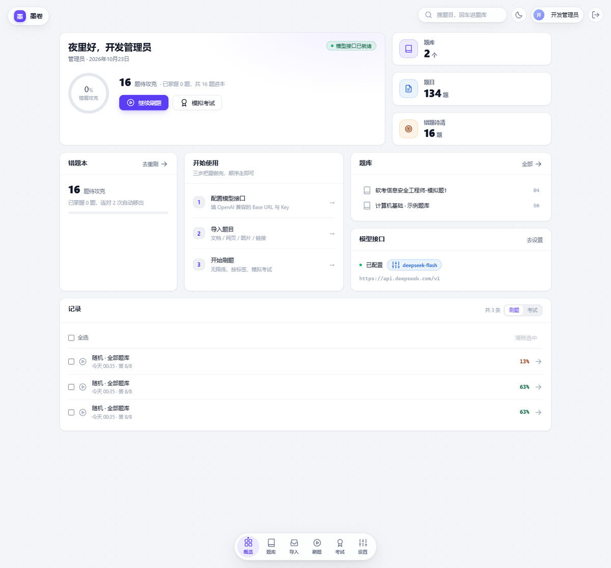
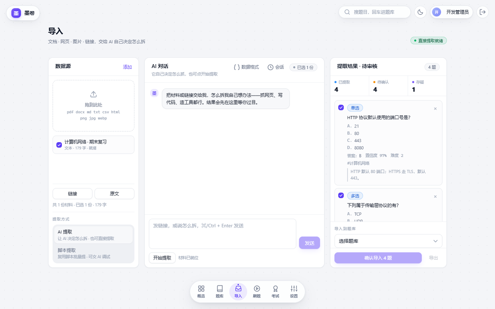
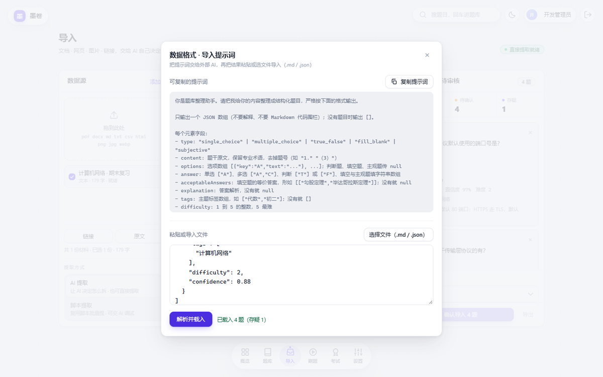
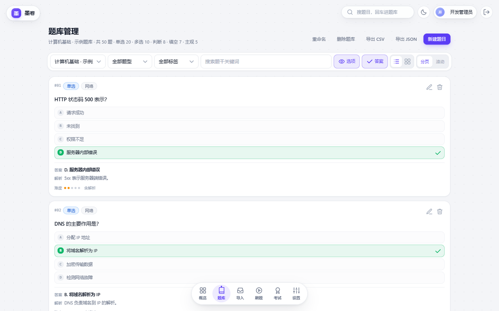
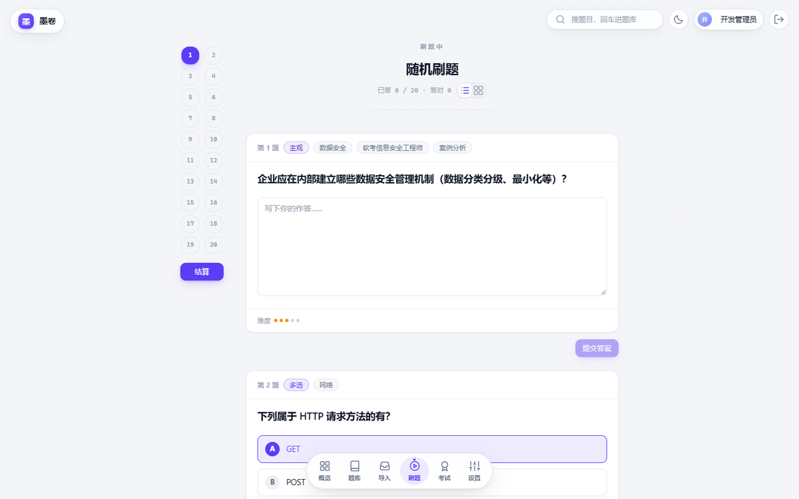
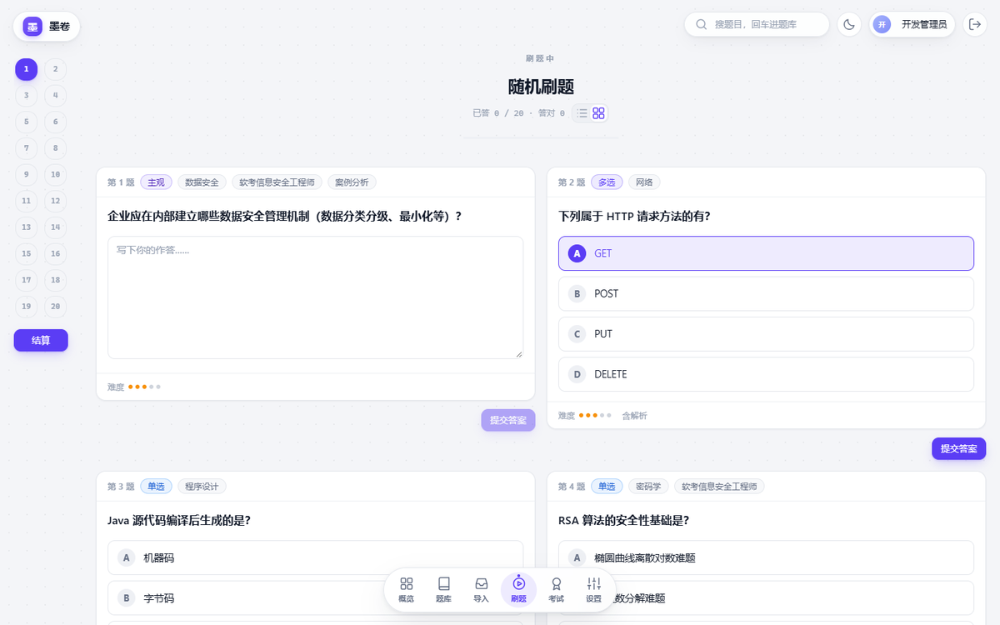
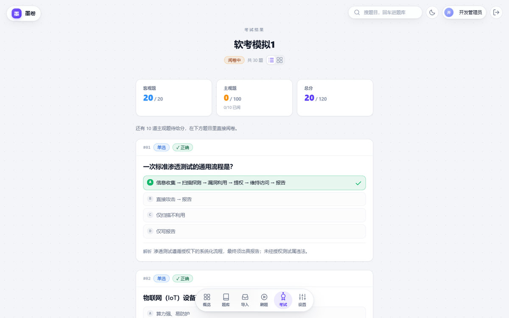

# 墨卷 · 刷题训练台

把散落在 PDF、网页、Word、截图里的题目收进一个题库，然后用「翻阅式」的方式一题题做完它。

市面上大多数刷题工具都要求你先按它的格式录题，墨卷反过来——**导入是核心功能**：把材料丢给 AI 对话，或者写一段 Python 脚本，由它自己决定怎么拆题，你只负责审核。其余部分（题库管理、刷题、考试、阅卷、记录）都围绕这个前提做减法。

前端 React 18 + Vite + Tailwind，后端 FastAPI + SQLite，单机自部署，数据全部留在本机。

## 界面

概览是一张 12 栏 Bento：待攻克、错题本、题库、模型接口、刷题与考试记录各占一格。



导入页三栏：左边堆材料，中间跟 AI 说怎么拆，右边候选题等你逐条过目。



不想开对话也行——「数据格式」里放了提示词，把外部 AI 整理好的 JSON 粘回来即可，报错会指到行列。



题库管理：吸顶筛选条，可一键展开选项与答案，正确项高亮。



刷题往下翻阅，单选与判断点选即判；答错停在原题给解析。



题目区也能换成网格，一屏看两道。



考试倒计时与进度吸顶常驻，交卷按钮钉在题号栏下方。


交卷后客观题立即出分，主观题就在结果页里逐题打分。



## 功能

**导入（差异化所在）**

- 三种入口：AI 对话提取、Python 脚本提取、粘贴 JSON（可用弹窗里的提示词让外部 AI 先整理好格式）
- 材料支持 PDF / DOCX / Markdown / TXT / CSV / HTML、网页链接、图片；网页里的图片会被下载下来交给视觉模型直读
- AI 助手是全站管理者：能建题库、读写脚本、跑代码、并发多步操作、中途停下来问你确认
- 提取结果进候选区，**必须人工审核才入库**，低置信度的题会标「存疑」
- 脚本模式跑在沙箱里：子进程隔离、60 秒超时、内存上限、导入守卫（默认无网络）

**题库**

- 多题库、多题型、标签、难度、来源追溯
- 吸顶筛选条 + 列表 / 网格两种浏览方式，可一键显示选项与答案
- 分页与无限滚动可切换，偏好记在本机

**刷题**

- 一组条件组一套题：范围（全部 / 错题本）× 题库 × 题型 × 标签 × 随机 / 顺序 × 题量
- 向下翻阅 + 侧栏题号跳转；单选与判断点选即判，答错停在原题看解析
- 题目区可切列表 / 网格布局；结算按钮钉在题号栏下方

**考试**

- 试卷（模板）直接在考试页增删改，可指定题库、题型分布、时长、是否乱序
- 组卷时就能看到每个题型「可抽多少题」，超了当场拦下，不用等后端报错
- 限时作答，剩余时间与进度吸顶常驻但不占版面；交卷后客观题立即出分，主观题在结果页内联阅卷

**记录**

- 概览里有全量刷题 / 考试记录，可多选清除，点开就是当时的答卷（逐题作答、正确答案、得分）

**其他**

- 多用户：进度、记录、评分按人隔离；题库 / 脚本 / 试卷默认共享，可设私有
- 首个注册的用户自动成为管理员；AI 接口与判分规则只有管理员能改
- 日间 / 夜间两套主题，桌面工作台风格的 Bento 概览

## 快速开始

### Windows：双击 `start.bat`

启动器会先把环境查一遍，缺什么装什么，然后拉起前后端并打开浏览器：

```
start.bat           检查环境 -> 装缺的依赖 -> 启动前后端
start.bat setup     只检查 + 装依赖，不启动
start.bat check     只打印环境报告，什么都不改
```

首次运行会依次完成：找到 Python 3.10+ → 装后端依赖 → 检查 Node 18+ → 装前端依赖 → 初始化 SQLite 并写入示例题库。

### 手动启动（任意系统）

```bash
# 后端（虚拟环境建在项目根，start.bat 会自动识别 .venv）
python -m venv .venv
source .venv/bin/activate                      # Windows: .venv\Scripts\activate
pip install -r backend/requirements.txt
cd backend
python seed.py                                 # 可选：建库 + 50 道示例题
python -m uvicorn app.main:app --host 0.0.0.0 --port 8000

# 前端（另开一个终端）
cd frontend
npm install
npm run dev -- --host
```

打开 http://localhost:5173 ，示例账号 `admin / mojuan-dev`（管理员）、`member / mojuan-dev`（普通用户）。

> 这两个是 `seed.py` 里的本地演示账号，部署到任何能被别人访问的地方之前请先改掉。

### 生产部署

前端构建产物由后端直接托管，跑一个进程就够：

```bash
cd frontend && npm run build
cd ../backend && python -m uvicorn app.main:app --host 0.0.0.0 --port 8000
```

然后访问 http://localhost:8000 。数据库与上传文件都在 `data/` 下，备份目录即可。

## 目录结构

```
backend/
  app/
    main.py              应用装配、静态托管、路由注册
    routers/             认证、设置、题库、导入、刷题、考试、阅卷、记录
    lib/
      agent/             导入助手：对话循环、工具集、流式输出、会话记录
      extract/           材料归一化（PDF/网页/图片）、解析、脚本沙箱
      practice/          组题、判分、序列化、错题本
      ai/                OpenAI 兼容客户端（含视觉模型）
    db/schema.sql        表结构
  seed.py                建库 + 示例题库
  smoke_test*.py         后端冒烟（需串行跑）
frontend/
  src/
    pages/               概览 / 题库 / 导入 / 刷题 / 考试 / 设置 / 登录
    components/          工作台外壳、题目卡、题号栏、各种弹窗
    lib/                 API 客户端、类型、工具
  scripts/               构建产物渲染冒烟、各页面截图脚本
docs/screenshots/        本 README 里的界面截图
start.bat                Windows 启动器（环境自检 + 一键装依赖）
```

## 配置

进「设置」页填写，全部存在本地数据库：

- **AI 接口**：OpenAI 兼容的 Base URL / API Key / 模型名，可在这里配任意兼容服务
- **视觉模型**：单独一项，用于直读题目截图（不做 OCR，直接多模态识别）
- **导入助手提示词**：内置一份，可在设置里改，也可一键恢复默认
- **判分规则**：多选题漏选是否给分等开关

## 数据与隐私

- 所有数据（题库、作答记录、上传材料）都在本地 SQLite 与 `data/` 目录里，不上传任何第三方
- 只有调用 AI 接口时，材料片段会发往你自己配置的那个服务
- `data/`、`node_modules/`、`dist/`、`.env` 都不入库

## 开发与验证

```bash
# 前端：类型检查 + 构建 + 在 jsdom 里真跑一遍打包产物（抓白屏）
cd frontend && npm run verify

# 后端：几个冒烟脚本要串行跑，SQLite 并发写会锁库
cd backend
python smoke_test.py && python smoke_test_extra.py && python smoke_test_import.py \
  && python smoke_test_feed.py && python smoke_test_scripts.py && python smoke_test_agent.py
```

后端全部使用 `TestClient` 起在进程内，不占用端口。

重新拍 README 截图（需要 Playwright + 本机 Edge）：把后端跑起来、`npm run build` 之后执行
`python frontend/scripts/shoot_readme.py`，图片写进 `docs/screenshots/`。

## 说明

- 面向单机 / 局域网自部署，没有做多租户隔离与横向扩展
- 脚本沙箱的「无网络」是尽力而为：本机部署时脚本的执行者就是使用者本人，请勿运行来路不明的脚本
- 未附加开源许可证文件；对外分发或商用前请自行确认，并替换掉仓库里的演示账号口令
